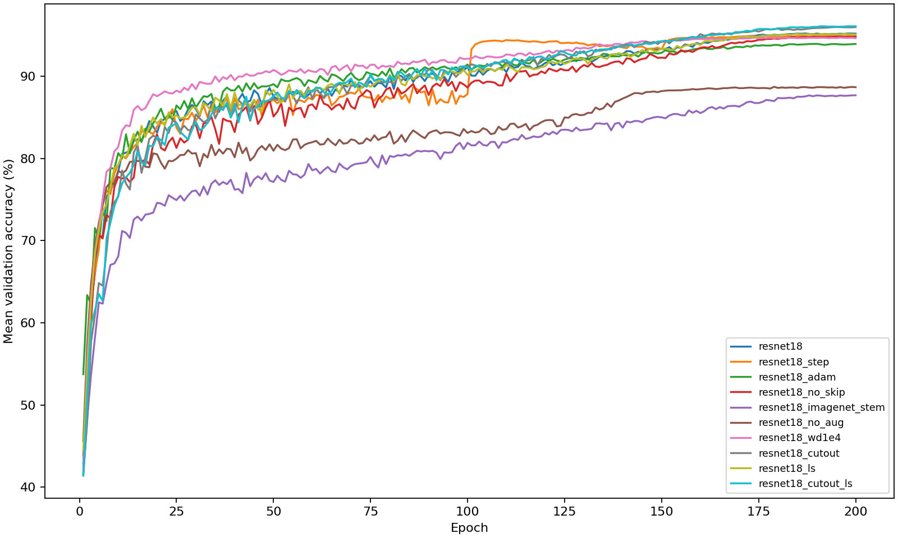
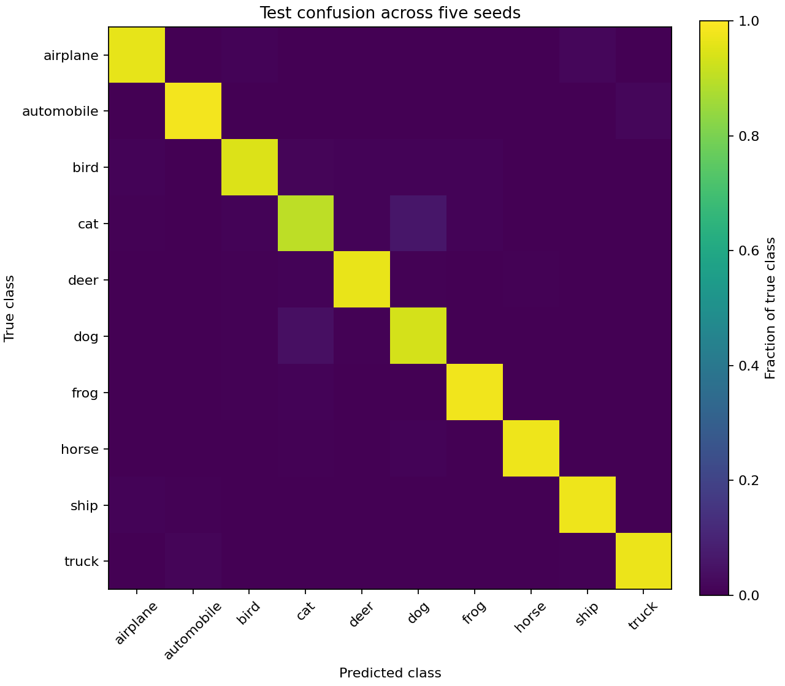

# ResNet-18 results

Selected configuration: `resnet18_cutout_ls`.

| Configuration | Best validation | Final validation |
| --- | ---: | ---: |
| resnet18 | 95.32% ± 0.26 pp | 95.19% ± 0.27 pp |
| resnet18_step | 95.08% ± 0.25 pp | 94.90% ± 0.29 pp |
| resnet18_adam | 94.07% ± 0.32 pp | 93.93% ± 0.28 pp |
| resnet18_no_skip | 94.91% ± 0.18 pp | 94.80% ± 0.24 pp |
| resnet18_imagenet_stem | 87.86% ± 0.35 pp | 87.69% ± 0.42 pp |
| resnet18_no_aug | 88.84% ± 0.21 pp | 88.67% ± 0.21 pp |
| resnet18_wd1e4 | 94.80% ± 0.13 pp | 94.64% ± 0.15 pp |
| resnet18_cutout | 96.08% ± 0.16 pp | 95.99% ± 0.15 pp |
| resnet18_ls | 95.24% ± 0.17 pp | 95.10% ± 0.24 pp |
| resnet18_cutout_ls | 96.14% ± 0.21 pp | 96.09% ± 0.26 pp |

| Seed | Test accuracy | Flip TTA accuracy |
| ---: | ---: | ---: |
| 17 | 95.85% | 96.20% |
| 29 | 96.08% | 96.40% |
| 43 | 95.74% | 96.19% |
| 61 | 95.95% | 96.28% |
| 83 | 95.89% | 96.29% |

Mean standard test accuracy is **95.90% ± 0.13 pp**.

Mean flip TTA accuracy is **96.27% ± 0.08 pp**.

The standard test score is +8.39 percentage points relative to the earlier plain CNN (87.51%).

| Class | Mean test accuracy |
| --- | ---: |
| airplane | 96.48% |
| automobile | 98.08% |
| bird | 94.64% |
| cat | 89.98% |
| deer | 96.58% |
| dog | 93.44% |
| frog | 97.66% |
| horse | 97.46% |
| ship | 97.46% |
| truck | 97.24% |

